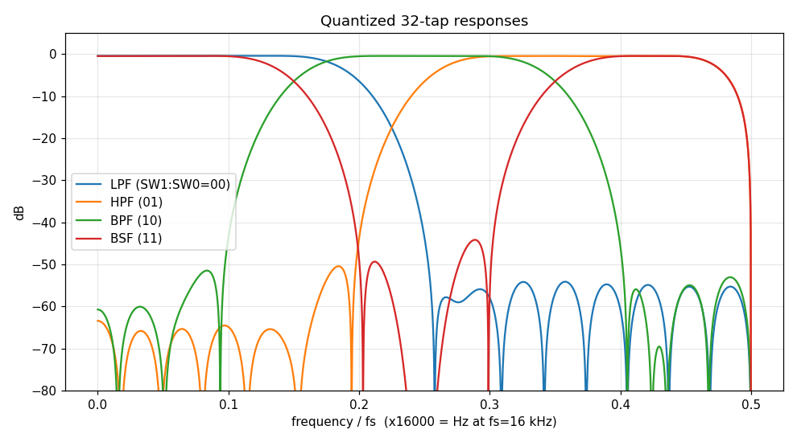
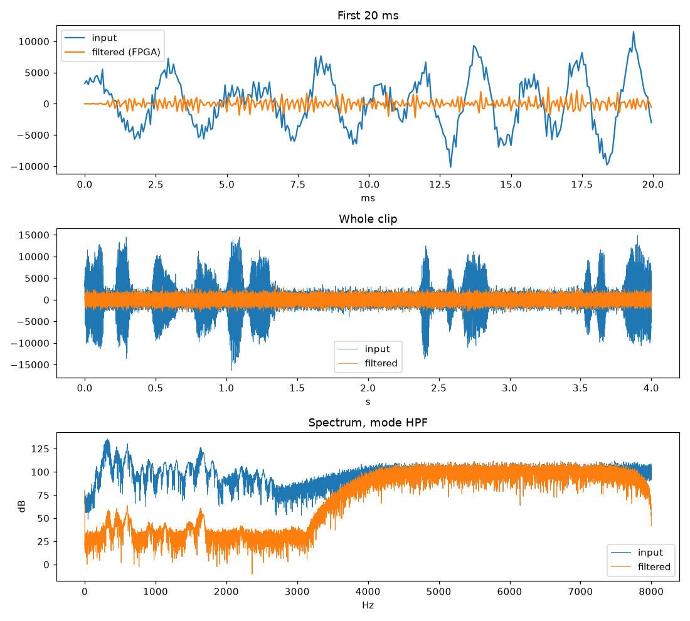
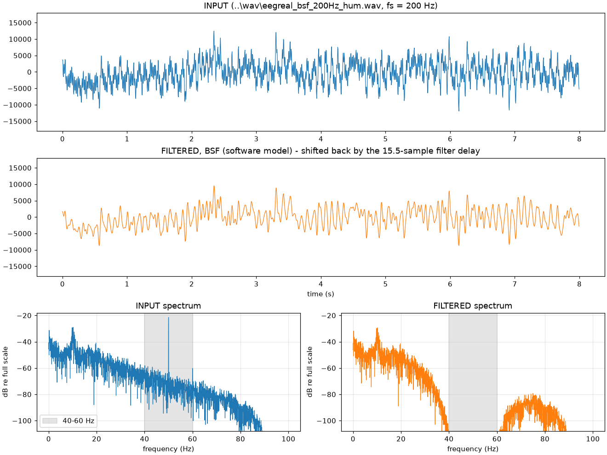

# FPGA-Based Multimode FIR Filter with UART Interface

A 32-tap symmetric finite impulse response (FIR) filter implemented in Verilog for FPGA-based digital signal processing. The design supports four selectable filtering modes and communicates with a host PC through a UART interface for signal input and output analysis.

## Overview

This project implements a configurable FIR filter for processing sampled signals on an FPGA. A symmetric coefficient structure is used to reduce the number of multiplications required by the filter. The filtering mode is selected using FPGA switches, while UART provides the interface for transferring signal samples between the FPGA and a host computer.

The project includes RTL modules, a testbench, FPGA constraints, coefficient-generation scripts, and Python utilities for audio and biomedical signal demonstrations.

## Features

- **32-tap symmetric FIR filter** with coefficient symmetry exploited in the datapath.
- **Four filtering modes:** low-pass (LPF), high-pass (HPF), band-pass (BPF), and band-stop (BSF).
- **UART communication** for transferring sampled data between the host PC and FPGA.
- **Switch-based mode selection** and a bypass mode for UART loopback testing.
- **Python-based analysis tools** for coefficient generation and signal-processing demonstrations.
- **Vivado build flow** with FPGA pin assignments and timing constraints.

## Hardware and Software

| Component | Details |
|---|---|
| FPGA development board | Digilent Nexys A7-100T |
| HDL | Verilog |
| FPGA design tool | AMD Vivado |
| Host-side processing | Python |
| Communication interface | UART |
| Filter length | 32 taps |
| Filter modes | LPF, HPF, BPF, BSF |

## Architecture

The design consists of the following functional blocks:

1. **UART receiver (`uart_rx.v`)** – receives serial data from the host computer.
2. **FIR filter (`fir_filter_32tap_modes.v`)** – processes input samples using the coefficients associated with the selected filtering mode.
3. **UART transmitter (`uart_tx.v`)** – sends processed data back to the host.
4. **Top-level controller (`fir_uart_modes_top.v`)** – integrates the filter and UART modules, handles mode selection, and controls the data flow.
5. **Host-side Python utilities** – prepare input signals, communicate with the FPGA, and analyse the results.

The symmetric FIR structure uses the relationship between coefficients on either side of the filter midpoint to reduce the multiplier count compared with a direct-form implementation using independent coefficients.

## Filtering Modes

| Switch setting (`SW1:SW0`) | Mode | Purpose |
|---|---|---|
| `00` | LPF | Retains lower-frequency components and attenuates higher-frequency components. |
| `01` | HPF | Attenuates lower-frequency components while retaining higher-frequency components. |
| `10` | BPF | Retains a selected frequency band. |
| `11` | BSF | Attenuates a selected frequency band, including the designed 50 Hz mains-interference region. |

The top-level design also provides a UART bypass mode for communication testing. Refer to the XDC constraints and RTL for the exact switch and button assignments.

## Results and Performance

The FIR filter was evaluated using audio and biomedical signal-processing demonstrations. The project report records the following results:

| Test | Reported result |
|---|---|
| Audio filtering | High-frequency noise attenuation of approximately 57 dB in LPF mode |
| High-pass filtering | Low-frequency component attenuation of approximately 68 dB in HPF mode |
| Biomedical BPF | 8–12 Hz band power increased from 56% to 92% of the analysed signal power |
| Biomedical BSF | 50 Hz mains-interference reduction of approximately 74 dB |

The report also describes processing 480,000 speech samples and comparing the FPGA output against a software reference.

### Visual Results

**Frequency response**



**Audio signal processing**



**Biomedical signal processing**



*Note: The numerical values above are reported in the project report. Reproduce and confirm them against the current RTL, coefficient set, and test data before presenting them as verified results for the latest revision.*


## Repository Structure

```text
FPGA-FIR-Filter-UART-Signal-Analysis/
├── constraints/
│   └── nexys_a7_uart_modes.xdc
├── docs/
│   └── mode_responses.png
├── pc/
│   ├── fir_audio.py
│   ├── fir_bio.py
│   ├── fir_modes_coeffs.py
│   └── make_bio_demo.py
├── rtl/
│   ├── fir_filter_32tap_modes.v
│   ├── fir_uart_modes_top.v
│   ├── uart_rx.v
│   └── uart_tx.v
├── scripts/
│   ├── build_modes_batch.tcl
│   └── design_modes.py
├── tb/
│   └── tb_fir_uart_modes_top.v
├── wav/
│   └── Sample signal files
├── .gitignore
└── README.md
```

## Building the FPGA Design

### Prerequisites

- AMD Vivado installed and configured.
- The required FPGA board support files.
- Python and the packages required by the selected host-side script.
- A compatible UART connection for hardware testing.

### Generate the Bitstream

Open the Vivado-configured command prompt, navigate to the repository root, and execute:

```bat
vivado -mode batch -source scripts/build_modes_batch.tcl
```

The build script is configured to generate the FPGA implementation. Check the script for the configured output directory and bitstream filename.

After implementation, inspect the timing and design reports. Confirm that the applicable timing constraints are met before programming the board.

## Running the Demonstrations

Connect the Nexys A7 board to the host computer and identify its serial port. Select the required filter mode using `SW1:SW0`.

Example commands, executed from the repository root:

```bat
python pc/fir_audio.py --port COMx --wav wav/netaji_high_frequency_noise.wav --mode lpf
python pc/fir_audio.py --port COMx --wav wav/netaji_high_frequency_noise.wav --mode hpf
python pc/fir_bio.py --wav wav/eegreal_bpf_40Hz.wav --mode bpf --port COMx
python pc/fir_bio.py --wav wav/eegreal_bsf_200Hz_hum.wav --mode bsf --port COMx
```

Replace `COMx` with the serial port assigned to the FPGA board. Check each script's help output for supported arguments and operating requirements.

The board must be programmed with the current bitstream before running the hardware demonstrations. Follow the switch and button sequence specified in the RTL and host-side scripts.

## Verification

The repository includes a testbench for the UART-connected multimode FIR design.

Before treating this revision as verified, run the testbench in Vivado and check that the reference model matches the current RTL, particularly for the band-stop filter coefficients. Review the simulation output for pass/fail status and investigate any mismatches.

For hardware validation, compare the FPGA output with a software reference using identical input samples, coefficients, fixed-point scaling, and rounding or truncation rules.

## Notes and Limitations

- The reported performance values are taken from the project report and should be revalidated against the current RTL and coefficient set.
- Filter performance depends on the input signal, sampling frequency, coefficient design, and fixed-point arithmetic.
- UART throughput and processing latency depend on the configured baud rate and implementation.
- The Python utilities provide host-side signal preparation, communication, and result analysis; they are not part of the FPGA datapath.
- Hardware validation requires a compatible FPGA board, a programmed bitstream, and a working UART connection.
